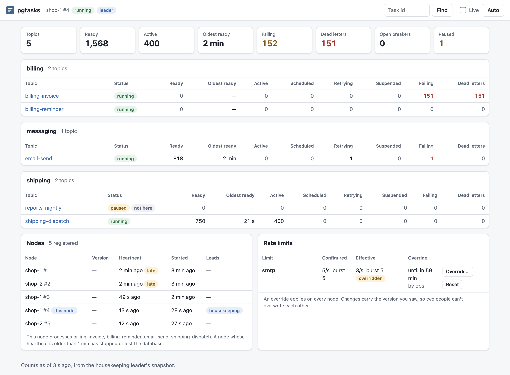

# Operations

## The schema

Everything lives in one schema, `pgtasks` unless you name another, as plain SQL files under
`io/github/khopland/pgtasks/postgres/db`. How it gets applied is up to you (`pgtasks.schema-mode`):

- `migrate` (default): the built-in runner applies the files at startup, under an advisory lock,
  so nodes starting together don't race. The application's user owns the schema.
- `validate`: Flyway, Liquibase or a DBA pipeline applies the same files, and the engine only
  checks the version. The runtime user then needs USAGE on the schema, SELECT, INSERT, UPDATE and
  DELETE on its tables, USAGE on `task_id_seq` and EXECUTE on `create_topic`. It needs no DDL
  rights: a topic is a row.
- `none`: nothing is checked.

Changing a trigger or table takes a lock that waits behind every open transaction that touched the
table, and every push and claim then queues behind the waiting change. So the built-in runner lets
each statement wait at most 5 seconds for a lock (`TaskSchema.migrate(dataSource, schema,
lockTimeout)` takes another limit). When one times out, it rolls the file back and tries again up to
five times, pausing 1, 2, 4 and 8 seconds in between. Then startup fails with a message that lists
the open transactions holding locks on the schema's tables, oldest first, such as an application
transaction that pushed and stayed open. With Flyway or Liquibase, set `lock_timeout` for the
migration's user yourself, for instance with `ALTER ROLE migrator SET lock_timeout = '5s'`.

`pgtasks.task_view` shows each task with its current state, for looking around in SQL.

### Naming the schema

`pgtasks.schema` (or `TaskEngineBuilder.schema(...)`, or the `PostgresTaskStore` constructor) names
the schema. Use it when `pgtasks` clashes with a schema of your own, or when two applications share a
database: each needs its own schema. The name must be a plain lowercase identifier
(`[a-z_][a-z0-9_]*`), at most 50 characters, not starting with `pg_` and not an SQL keyword. The
notification channels follow it (`<schema>_ready`, `<schema>_topic`), so
applications in one database don't wake each other's workers.

The SQL files write the name as the placeholder `${pgtasks_schema}`. The built-in runner fills it
in. With another tool, pass the same name the engine uses:

- **Flyway**: a Flyway instance of its own, so its version numbers don't clash with the
  application's migrations, with the name as a placeholder. Flyway needs the placeholder even for
  the default name:

  ```java
  Flyway.configure()
      .dataSource(dataSource)
      .locations("classpath:io/github/khopland/pgtasks/postgres/db")
      .schemas("billing_tasks")                                   // the history table goes here
      .placeholders(Map.of("pgtasks_schema", "billing_tasks"))
      .table("flyway_task_history")
      .load()
      .migrate();
  ```

  With Spring Boot, run it from a `FlywayMigrationStrategy` bean, before the application's own
  migrations (which may refer to the pgtasks schema, for instance to grant the runtime role
  access), and set `pgtasks.schema-mode=validate`. The engine starts after every bean is ready,
  so it finds the schema in place:

  ```java
  @Bean
  FlywayMigrationStrategy migrations(DataSource dataSource) {
      return application -> {
          Flyway.configure()...load().migrate();   // pgtasks, as above
          application.migrate();
      };
  }
  ```

  Flyway creates the schema it is given before V001 runs, so its log says
  `schema "pgtasks" already exists, skipping` for V001's `CREATE SCHEMA IF NOT EXISTS`. That is
  expected.

- **Liquibase**: include `io/github/khopland/pgtasks/postgres/db/changelog.xml` from your changelog.
  The changelog parameter `pgtasks_schema` names the schema and defaults to `pgtasks`. Set it before
  the include is parsed: with `spring.liquibase.parameters.pgtasks_schema=billing_tasks`,
  `liquibase.setChangeLogParameter("pgtasks_schema", ...)`, `-Dliquibase.parameter.pgtasks_schema=...`,
  or a `<property name="pgtasks_schema" value="billing_tasks"/>` above the include. The changeSet
  ids carry the name (`billing_tasks-V001`), so two schemas can share one `DATABASECHANGELOG`.
- **A DBA pipeline**: replace the placeholder in each file, for instance with
  `sed 's/\${pgtasks_schema}/billing_tasks/g'`, and run the files in the order of `TaskSchema.FILES`.

### Changing the schema

Nothing is released yet, so `V001__tasks_schema.sql` still changes in place. Once 0.1.0 ships,
it is frozen. **Never edit a released versioned file**: databases
that applied it would no longer match it. The built-in runner refuses to start when an applied
file's checksum changed, and Flyway and Liquibase do the same. Add the next file instead:

1. The next `V<version>__<what>.sql`: the change, written so that the previous release's nodes still run against it during a rolling
   deploy, or with `compatible_from` raised if they can't. It ends by recording its version in the
   meta table, like V001. Use `${pgtasks_schema}` for every name.
2. Add it to `TaskSchema.FILES`, as a `changeSet` in `changelog.xml`, and raise `TaskSchema.VERSION`.
3. Functions, views and triggers stay in the `R__` files, which may change at any time: every path
   applies them again when their content changes. Dropping or changing a view's column needs a
   versioned file. **Raise the `-- revision: <n>` line in the file's header with every change.**
   The built-in runner records the revision in `schema_history` and never applies a file over a
   higher revision, so during a rolling deploy an old node that restarts leaves the new node's
   functions, views and triggers alone (it logs that it did). Without the revision it would apply
   its own older definitions again, and the new ones would stay rolled back until a new node
   restarted. Flyway and Liquibase re-apply an `R__` file whenever its content differs from the
   last one they applied, whatever the revision: run them once per release from the pipeline, not
   from every node at startup.
4. `SchemaFreezeTest` holds the checksum of every released versioned file and fails if one changes.
   Add the new file's checksum there when it is released. It also pins the checksum of every
   revision of every `R__` file, so changing one without raising its revision fails the build; add
   the new revision's checksum next to the old ones. With the first release, add an upgrade test
   that applies the released files with tasks in every state, then the current files, and checks
   the tasks are still usable.

## Postgres versions

pgtasks supports PostgreSQL 17 to 19. CI runs the full build on 17 and the store TCK (plan audit
included), the engine's Postgres tests and the starter's tests on 18 and 19.

17 is the floor because of plans, not syntax. The store's statements are written so that each
reads only the rows it needs whatever the tables' statistics say, and the plan audit checks that
on every supported version. On 15 and 16 that doesn't hold: the planner costs `= ANY (array)` on
an index's second column differently, and a SUPERSEDE or REPLACE push can walk its topic's whole
queue. So with schema mode `MIGRATE` or `VALIDATE` the store refuses to start on a server older
than 17, before it applies anything. `NONE` skips that check with the others.

To run the tests on another version, name its major version. Maven picks the matching embedded
binaries, and the tests check that the server they reach runs that version:

```
mvn verify -pl pgtasks-postgres -am -Dpgtasks.test.postgres.version=18
```

The same property checks an external server given with `pgtasks.test.postgres.url`.

Plans differ between versions. From 18 on, an index whose leading column isn't constrained can be
used with a skip scan, so some statements that walk a whole index on 17 descend it once per value
of the leading column instead. The store's statements don't rely on that.

## Actuator: the tasks endpoint and health

Expose it like any endpoint: `management.endpoints.web.exposure.include=health,tasks`.

```
GET    /actuator/tasks                                   topics by module, this node and every node
GET    /actuator/tasks/topics/{topic}                    status, counts, settings and where each came from
GET    /actuator/tasks/topics/{topic}/dead-letters?after=&limit=
GET    /actuator/tasks/topics/{topic}/tasks?after=&limit=&identifier=&reference=&state=scheduled,retrying&header=tenant=north&createdFrom=&createdUntil=
POST   /actuator/tasks/topics/{topic}/revive | discard   {"ids": "1,2"}, or {"error": "...", "failedFrom": "...", "failedUntil": "..."}, or {"all": "true"}
POST   /actuator/tasks/topics/{topic}/purge              {"outcome": "succeeded", "before": "2026-01-01T00:00:00Z"}
DELETE /actuator/tasks/topics/{topic}                    a topic no longer used, with its history
GET    /actuator/tasks/tasks/{id}                        a task
```

Every `POST` needs `Content-Type: application/json` and a JSON object body, `{}` at least.
Without one, Actuator answers 415; with Spring Security rules that deny everything else, the
error dispatch that follows can then show up as a 403 that looks like a CSRF failure.

Payloads, outputs and error messages often contain personal data, so the endpoint hides them
unless `management.endpoint.tasks.show-values` allows it: `never` (default), `when-authorized`
(with `management.endpoint.tasks.roles`), or `always`. Errors keep their exception type, so you
can still tell failures apart and revive them by type. Everything here is also library API, on
`engine.admin()`.

The `tasks` health indicator is UP while the engine runs and its heartbeat is on time. It is
DOWN if the heartbeat is late or the database can't be reached, and OUT_OF_SERVICE before start
and after stop. Its details show leadership, notifications, and claims stuck past their deadline,
without changing the status.

## Dashboard



A web page over the tasks endpoint, for Spring MVC applications with Actuator. It's in the starter,
off by default:

```yaml
pgtasks:
  dashboard:
    enabled: true
    path: /pgtasks          # the default
management:
  endpoints.web.exposure.include: health,tasks
```

Then open `http://<host>/pgtasks/`. It shows:

- **Overview**: topics grouped by module, with their counts per state, the age of the oldest ready
  task, failing tasks and dead letters, and whether this node runs it.
  Every registered node with its heartbeat (marked late after the lease term) and what it leads.
- **Topic**: counts, a paged list of dead letters to revive or discard by id (or all of them), the topic's effective settings
  and where each came from, purge and delete.
- **Unfinished tasks** (on the topic page): search by identifier, reference, state, a header and
  when they were pushed. A search runs when you ask and on a page change or after a change, not on every refresh, since
  one without an identifier or reference reads the topic's backlog.
- **Task**: look one up by id in the header, with its error.

Discards, purges and deletes ask for confirmation, and the ones that can't be undone at scale
(discarding every dead letter, purging, deleting a topic) ask you to type the topic's name.
"Live" refreshes the page every 10 seconds.

**Security.** The page holds no data and has no server logic of its own: it reads and changes
everything through `/actuator/tasks`, so it has exactly the endpoint's security, and shows
payloads, outputs and error messages only as far as `management.endpoint.tasks.show-values`
allows. Secure the dashboard's path like the endpoint, since its pages show the same things. It
renders all data as text, never as HTML, and every response carries a Content-Security-Policy that
allows only its own scripts and styles and no framing. It works offline: no CDN, no fonts.

With Spring Security, the page's changes are POST and DELETE requests to the endpoint, so they
need a CSRF token. The page gets it from `<path>/config.json`, which reads Spring Security's token
for the request and hands it to the page; the page sends it in the header Spring Security names
(`X-CSRF-TOKEN` by default). This needs no configuration, as long as the dashboard's path goes
through the same security filter chain, with CSRF on, as the endpoint. With
`CookieCsrfTokenRepository` the page also falls back to sending the `XSRF-TOKEN` cookie as
`X-XSRF-TOKEN`. If you turned CSRF off for `/actuator/**`, nothing is needed either. For example:

```java
@Bean
SecurityFilterChain security(HttpSecurity http) throws Exception {
    return http
        .authorizeHttpRequests(auth -> auth
            .requestMatchers("/pgtasks/**", "/actuator/tasks/**").hasRole("OPS")
            .anyRequest().authenticated())
        .formLogin(Customizer.withDefaults())
        .build();
}
```

The page finds the endpoint at `<context path><management base path>/tasks`. If a proxy rewrites
paths, set `pgtasks.dashboard.endpoint` to the URL the browser should call. If the endpoint isn't
exposed, the page says so. WebFlux applications aren't supported.

### When Actuator is on a port the browser can't reach

In Kubernetes, Actuator often runs on its own port (`management.server.port`) that only the
kubelet and Prometheus reach, so the page on the application's port can't call it. Then let the
dashboard serve the same operations itself, next to the page:

```yaml
pgtasks:
  dashboard:
    enabled: true
    path: /admin/pgtasks
    api: dashboard          # the API at /admin/pgtasks/api; default: actuator
```

The page is at `/admin/pgtasks/` and its API at `/admin/pgtasks/api/...`, with the same paths,
bodies and answers as `/actuator/tasks` (the tasks endpoint itself needn't be exposed). Values are
still hidden as `management.endpoint.tasks.show-values` says, with `when-authorized` checking the
roles of the request's user.

This puts operations that change tasks on the application's port, so the application's own
security must protect the whole path, and it is off unless you ask for it. With Spring Security,
one rule covers the page and its API, and CSRF works as above:

```java
.authorizeHttpRequests(auth -> auth
    .requestMatchers("/admin/pgtasks/**").hasRole("OPS")
    .anyRequest().authenticated())
```

Without Spring Security the dashboard logs a warning at startup. Keep the path off your public
ingress (route it only through an internal one, or reach it with `kubectl port-forward`). Each pod
shows the same topics, counts, dead letters and nodes, since they come from the database;
"running" is that pod's own.

## Metrics and alerts

With Micrometer (Spring Boot Actuator sets it up), the engine records:

| Metric | In Prometheus | What |
|---|---|---|
| `pgtasks.push`, `pgtasks.batch`, `pgtasks.task` | `pgtasks_push_seconds_count`, `_sum`, `_max` (and `batch`, `task` alike) | Observations (timers, and spans with tracing) of pushes, batches, and each task a handler decides one by one |
| `pgtasks.pushed{topic,status}` | `pgtasks_pushed_tasks_total` | Committed pushes |
| `pgtasks.completed{topic,result}` | `pgtasks_completed_tasks_total` | Completed tasks: succeeded, filtered, suspended, delayed, unavailable (a failure the retry policy doesn't count), retrying, dead-lettered |
| `pgtasks.queue{topic,state}` | `pgtasks_queue_tasks` | Unfinished tasks per state, from the last snapshot |
| `pgtasks.queue.oldest.ready{topic}` | `pgtasks_queue_oldest_ready_seconds` | Seconds since the oldest ready task was pushed |
| `pgtasks.queue.failing{topic}` | `pgtasks_queue_failing_tasks` | Tasks whose last run failed |
| `pgtasks.queue.oldest.failing{topic}` | `pgtasks_queue_oldest_failing_seconds` | Since when the longest-failing task has failed |
| `pgtasks.queue.snapshot.age{topic}` | `pgtasks_queue_snapshot_age_seconds` | Seconds since the counts were taken |
| `pgtasks.queue.topics` | `pgtasks_queue_topics` | Topics in the last snapshot |

Prometheus names add the base unit and, for counters, `_total`, as Micrometer's Prometheus
registry writes them. Write alerts against those.

Ready to use, in [`docs/monitoring`](monitoring):

- [`pgtasks-alerts.yml`](monitoring/pgtasks-alerts.yml): Prometheus alerting rules for the alerts
  below, plus dead letters and missing metrics. Load it with `rule_files`, or as a
  `PrometheusRule`'s groups.
- [`pgtasks-dashboard.json`](monitoring/pgtasks-dashboard.json): a Grafana dashboard (import it,
  pick the Prometheus data source) with dead letters, failing tasks, queue states, throughput by
  result, the oldest ready task and batch times, per topic.

Queue gauges come from snapshots the housekeeping leader takes every minute, so scraping never
counts the queue. Alert on:

- `pgtasks.queue.oldest.ready`: work is waiting longer than it should. It also catches a topic no
  node processes any more.
- `pgtasks.queue.oldest.failing`: something has been failing for a while. Dead letters can take
  days to appear.
- `pgtasks.queue.snapshot.age` growing past a few minutes: no node runs housekeeping.
- The health indicator going DOWN.

## Tracing and correlation

Traces follow a task from the code that pushed it through every topic downstream. Every header the
tracer's propagator writes is stored with the task (`traceparent` and `tracestate`, `baggage`,
`b3`, ...), so W3C, B3 and remote baggage fields all carry over. A trace looks like this:

```
POST /returns
  push assessment            the push, a producer span
    process assessment       the batch
      handle assessment      the task, while its decider runs
        push notify          its downstream work
          process notify
            handle notify
```

A batch continues its tasks' trace when they all share one, such as a batch of one or of tasks
pushed together. A batch of tasks from different traces starts a trace of its own, and each
task's `handle` span continues the trace that task was pushed from, so none of them is cut off
and each task's downstream work stays in its own trace. Tasks get their own span when the handler
goes through `batch.decide`, `decideConcurrently` or `eachTask`, and when they have downstream
work; a handler that only returns `Decisions` for the whole batch is traced as the batch.

The MDC carries `task.topic`, and `task.id` and `task.identifier` while a task's own span is
current (and for batches of one).

For a correlation id without tracing, or next to it, name the MDC keys to carry:

```yaml
pgtasks:
  mdc-headers: korrelasjonsid
```

or `builder.observer(TaskObserver.mdc(List.of("korrelasjonsid")))`. Each key the MDC has when a
task is pushed, typically set by a web filter for the request, is stored as a header of that
name, and is in the MDC again while a handler works on the task, so log lines carry it and
downstream pushes pick it up again. The value comes from the task: a handler that wants to give
downstream work a new one sets the header on the creation. With tracing, a remote baggage field
(`management.tracing.baggage.remote-fields` and `correlation.fields`) does the same through
`baggage`.

Headers are a `jsonb` column, so support can find a flow by its correlation id:

```sql
SELECT * FROM pgtasks.task_view WHERE headers->>'korrelasjonsid' = '...';
```

Add an index on that expression if you look them up often. The endpoint shows header names, and
their values only where `show-values` allows.

## Dead letters

1. Look at what fails: `GET .../topics/{topic}/dead-letters` lists them with their errors. An
   error is an object, `{"type": ..., "message": ..., "stack": ...}`, the type alone when values
   are hidden.
2. Fix the cause and deploy the fix.
3. Revive by error type and time range, or by ids. Discard what should never run. Nothing
   revives or discards every dead letter of a topic without `"all": "true"`.

## Unfinished tasks

What [concepts](concepts.md#searching-unfinished-tasks) describes, from the endpoint or
`engine.admin()`:

```java
TaskQuery stuck = TaskQuery.ALL.withIdentifier("person-42").inStates(QueueState.RETRYING);
admin.tasks("assessment", stuck, 50);            // a page, lowest id first; next page: stuck.after(lastId)
```

- Cost: a search finds its tasks by identifier, reference or ids through an index.
  With only a state, a header or a time range it reads the topic's whole backlog once per page,
  as counting the topic does. Fine for occasional use; don't poll it. (An index on
  `queue (topic_id, task_id)` would avoid that, at a cost to every push and claim, so there is none.)
- The search shows payloads, outputs, errors and header values under the same `show-values` rules
  as dead letters. Filtering by a header's value still works when values are hidden.

## Retention

Finished tasks are deleted by the housekeeping leader, per topic and outcome, counted from
completion: succeeded after 30 days, filtered, redundant and recreated after 7,
failed (discarded dead letters) never. Change it per topic with `options.retain(Outcome.SUCCEEDED, Period.ofDays(90))`,
for every topic in `TaskGlobals`, or per environment with `pgtasks.topics.<t>.retain.succeeded: 90d`.
Each run deletes for at most 30 s and the next one goes on from where it stopped, so a large
backlog after downtime can't hold up housekeeping.

If retention empties `pgtasks.task` and Postgres analyzes it before vacuum gives its pages back,
the statistics say the table has pages but no rows. Until the next analyze, the planner can then
read every task for a claim or a completion. So the engine checks at start and with each count
snapshot (every minute on the leader), and runs `ANALYZE pgtasks.task` when the statistics say
empty and a row exists. The role the application connects as needs to own the table for that;
otherwise Postgres skips it with a warning and autovacuum repairs the statistics after about 50
new tasks.

## Connections

Each node uses the application's `DataSource`:

- Claims and completions use a connection each, at most `maxInFlightBatches` at once: by default
  half the pool, up to 8 (5 with Spring Boot's default pool of 10). Handlers hold no connection
  of the engine's while they run.
- Housekeeping uses up to 4: the heartbeat, the regular jobs, retention and reloads.
- Notifications listen on a long-lived connection. With HikariCP it is opened outside the pool;
  with other pools it takes one of the pool's.
- Wake-ups for pushes the engine sees commit take a short transaction of their own, at most one
  every 10 ms per node, whatever the push rate (see below).

A heartbeat that can't get a connection for long enough (10 minutes by default) lets other nodes
requeue this node's tasks while it still runs them. The engine warns at startup if
`maxInFlightBatches` leaves too little room in the pool.

LISTEN needs a session. Behind PgBouncer in transaction mode, give notifications a direct
connection (`builder.notifier(new PostgresNotifier(...))`) or turn them off with
`pgtasks.notifications=false`; polling still finds the work, within the poll interval. Use
`validate` there too, since the built-in runner's advisory lock is per session.

### Wake-ups and the notify lock

Postgres serializes the commits of all transactions that sent a `NOTIFY`, behind one
database-wide lock held until the commit is flushed. A notification sent inside every pushing
transaction would cap a busy application's commit rate near one commit per WAL flush (measured at
about 500 a second on a 2 ms flush, against over 4,000 without the notification), and
show up as slow commits across the whole database, waiting in `Lock:object` on `pg_database`.
Pushes as described next commit as fast as with no notification at all; see the
[benchmark](benchmarks/2026-11-22-notify-and-throughput.md).

So pushes the engine sees commit don't notify inside the transaction: `tasks.push(...)` in a
bound transaction (Spring, `JdbcTransactions`), `tasks.independently()`, and downstream work
staged with `task.push(...)`. After the commit the engine wakes its own workers and sends the
notification from a short transaction of its own: at once after a quiet spell, then at most once
every 10 ms per node, covering every topic pushed to meanwhile. A node that stops between the
commit and the notification loses that wake-up; other nodes find the task at their next poll.

Pushes the engine doesn't see commit still notify at their commit, through the queue's insert
trigger: `tasks.on(connection)` and rows inserted with plain SQL. They never lose a wake-up, but
they queue for the lock. If an application pushes that way from many concurrent transactions,
push with `tasks.push(...)` in a bound transaction instead.

## Deploys and shutdown

- On shutdown the engine stops claiming, lets running batches finish for
  `pgtasks.shutdown-timeout` (30 s), then hands back what is left without counting an attempt.
- Rolling deploys are safe: nodes of old and new versions share the schema, which records the
  oldest library version it stays compatible with.
- A deleted topic stops on every node
  within about a second through LISTEN/NOTIFY, and within one heartbeat (15 s) otherwise.
- One node at a time holds the housekeeping lease (four heartbeats long), which moves to another
  node if it stops renewing it.
- A node that dies without stopping (`kill -9`, an OOM kill, a lost VM) keeps its claims until it
  counts as dead: no heartbeat for the expiry, 10 minutes by default. Then another node requeues
  its tasks. Under a `SINGULAR_*` ordering those tasks also hold back every later task for their
  identifiers until then. `pgtasks.node-expiry` shortens it, and `pgtasks.heartbeat` sets how
  often a node writes that it is alive (15 s); both override a `TaskGlobals` bean. Keep the expiry
  several heartbeats long, so a short pause or a slow database doesn't count as death:

  ```yaml
  pgtasks:
    heartbeat: 5s
    node-expiry: 2m
  ```
- A node that stops gracefully removes its row from `pgtasks.node`, so the endpoint and the
  dashboard list only live nodes and ones that died. Each start registers a new row.
- A node is named `<spring.application.name>@<host>`, where the host is `HOSTNAME` (the pod's name
  in Kubernetes) or the machine's name, so the instances of one deployment tell apart.
  `pgtasks.node` names it yourself.

## Logging

The library logs through the SLF4J 2 API and brings no backend: Spring Boot's Logback picks it
up without any setup, and elsewhere any SLF4J provider on the classpath does (without one, SLF4J
prints a warning and drops the messages). Loggers are named after the classes, under
`io.github.khopland.pgtasks`. INFO covers lifecycle events such as topics starting and
stopping, schema migrations and lease changes.
